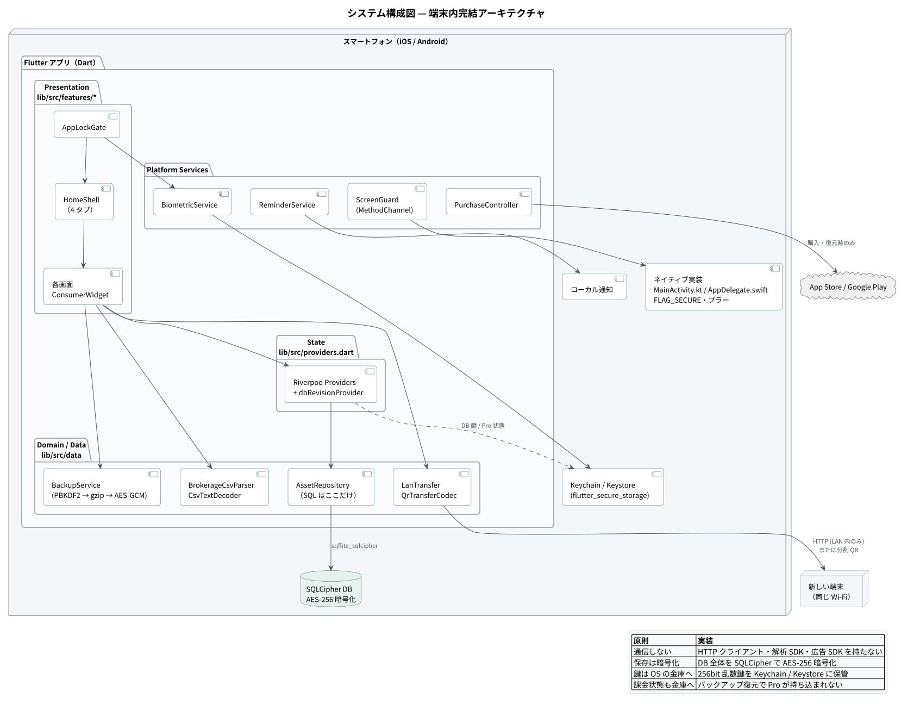
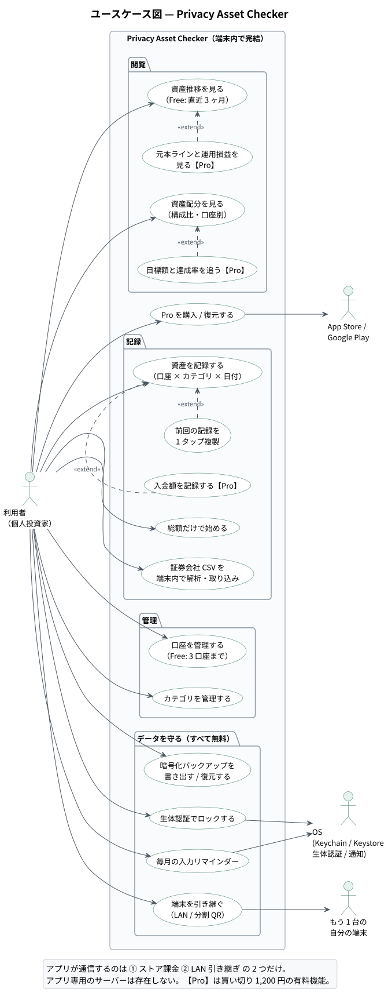
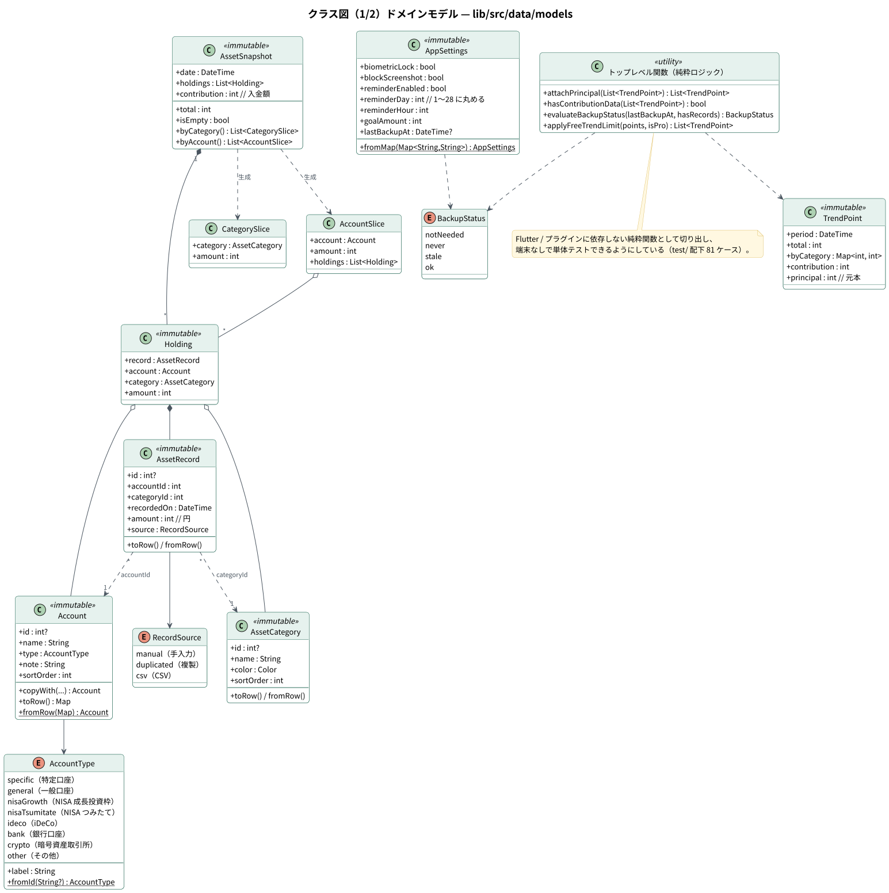
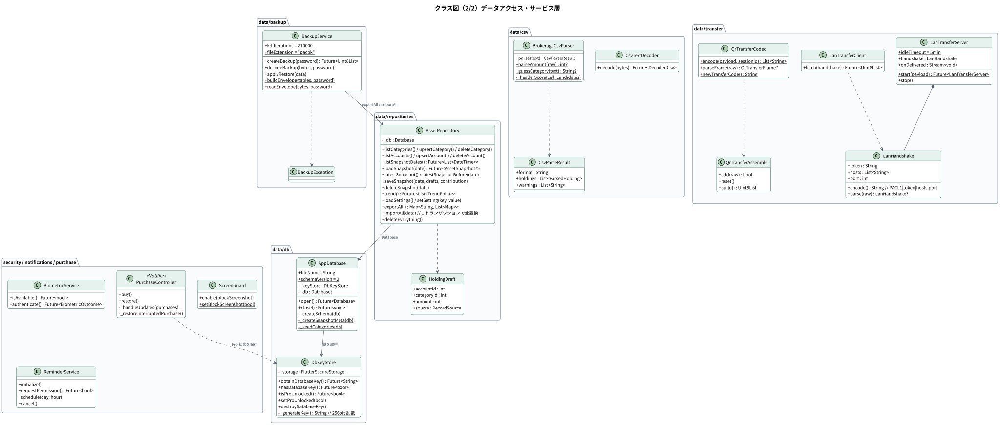
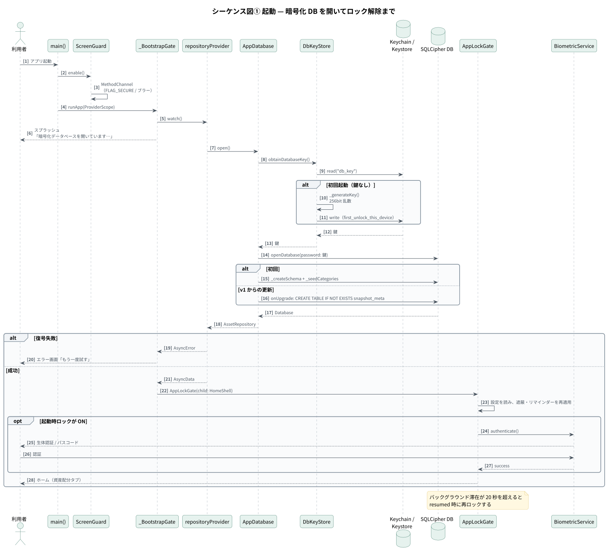
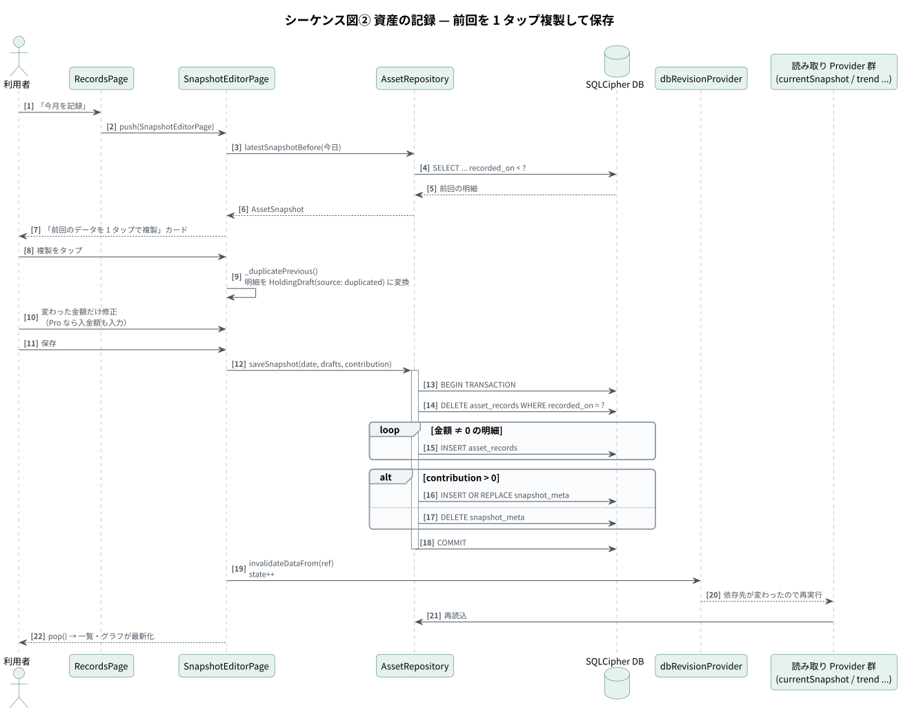
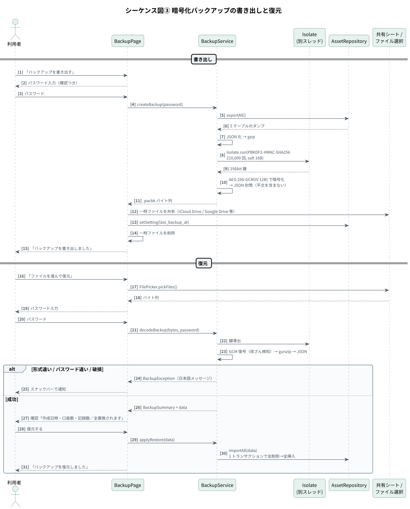
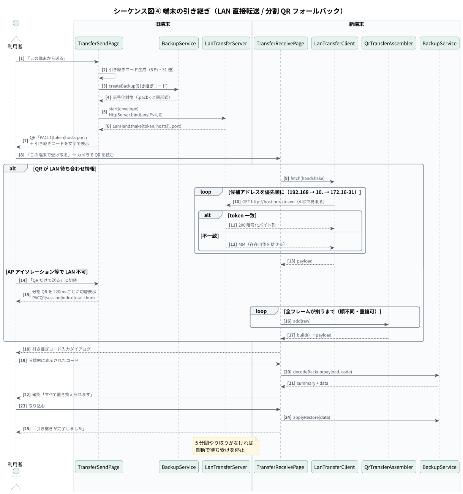
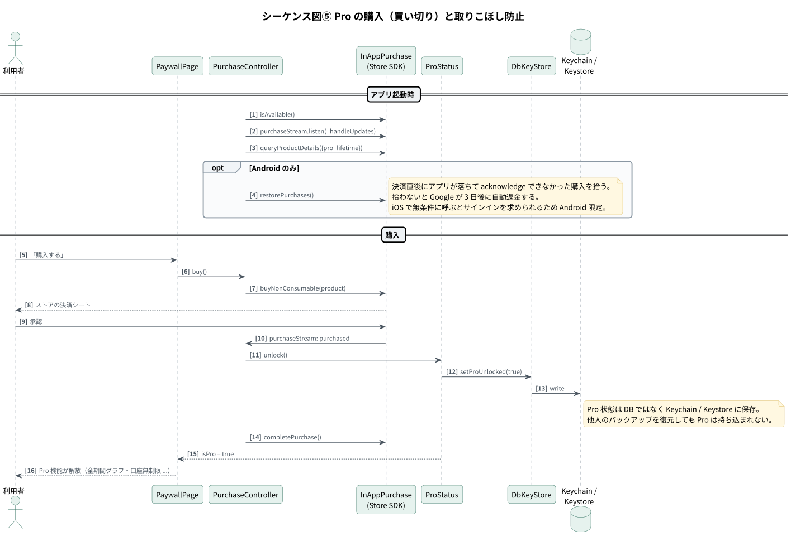
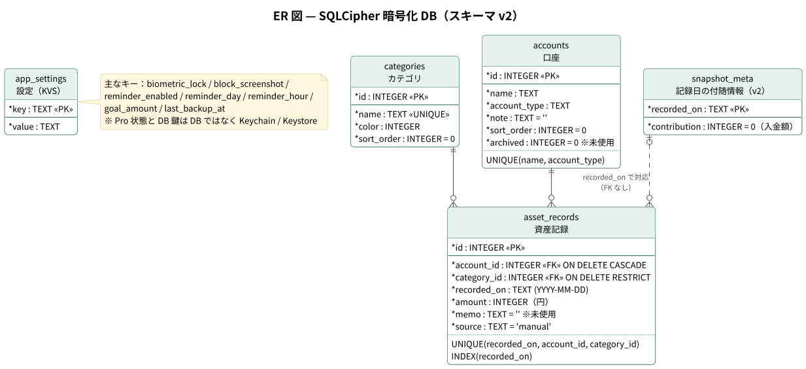

# 設計書 — Privacy Asset Checker

1. [システム構成](#1-システム構成)
2. [レイヤー構成と責務](#2-レイヤー構成と責務)
3. [クラス図](#3-クラス図)
4. [シーケンス図](#4-シーケンス図)
5. [データベース設計](#5-データベース設計)
6. [セキュリティ設計](#6-セキュリティ設計)
7. [状態管理（Riverpod）](#7-状態管理riverpod)
8. [ディレクトリ構成](#8-ディレクトリ構成)

図の元になる PlantUML は [`diagrams/src/`](diagrams/src/) に、SVG は [`diagrams/svg/`](diagrams/svg/) にあります。

---

## 1. システム構成



**アプリ専用のサーバーを持たない**ことが、この製品の前提です。資産データは端末内の SQLCipher（AES-256）に保存し、復号キーは OS のセキュア領域（iOS Keychain / Android Keystore）に置きます。

| 通信が発生する場面 | 相手 | 理由 |
|---|---|---|
| アプリ内課金（購入・復元のときだけ） | App Store / Google Play | ストア SDK が各社サーバーと通信する |
| 端末の引き継ぎ（ユーザーが開始したときだけ） | 同じ Wi-Fi 上の自分のもう 1 台 | 暗号化済みのバイト列を HTTP で渡す。ルーターの外へは出ない |

上の 2 つ以外に、HTTP クライアント・解析 SDK・広告 SDK・リモート設定は一切組み込んでいません。QR 読み取りの ML Kit も、モデルを動的ダウンロードしない**バンドル版**を選んでいます。

### ユースケース



---

## 2. レイヤー構成と責務

| レイヤー | 場所 | 責務 | 主なクラス |
|---|---|---|---|
| Presentation | `lib/src/features/<画面>/` | 画面ごとの Widget。1 画面 1 ディレクトリ | `AllocationPage`, `SnapshotEditorPage`, `BackupPage` |
| 共通 UI | `lib/src/widgets/common.dart` | 画面をまたいで使う部品 | `SectionCard`, `MoneyHeadline`, `ProUpsellBanner`, `AmountField` |
| State | `lib/src/providers.dart` | Riverpod の Provider をすべて手書きで定義（コード生成なし） | `repositoryProvider`, `dbRevisionProvider`, `proStatusProvider` |
| Data | `lib/src/data/` | DB・暗号化・CSV・転送。**SQL は `AssetRepository` だけ**が触る | `AssetRepository`, `BackupService`, `BrokerageCsvParser` |
| Platform | `lib/src/security/`, `notifications/` | OS 機能のラッパー | `BiometricService`, `ScreenGuard`, `ReminderService` |
| Native | `MainActivity.kt`, `AppDelegate.swift` | 画面遮蔽の自前プラグイン | `MethodChannel("jp.privacyasset/screen_guard")` |

**テストしやすさのための切り出し**：集計や判定のロジックは、Flutter やプラグインに依存しないトップレベル関数・static メソッドとして切り出しています（`attachPrincipal`, `evaluateBackupStatus`, `applyFreeTrendLimit`, `BackupService.buildEnvelope` など）。これにより実機やエミュレータなしで 81 ケースの単体テストを回せます。

---

## 3. クラス図

### 3-1. ドメインモデル



- すべて `@immutable`。`copyWith` と `toRow()` / `fromRow()` を対で持つ
- 列挙型は日本語の `label` と、未知の値でも例外にせず既定値へ落とす `fromId` を持つ
- 金額はすべて `int`（円）。表示の直前でだけ `Fmt.yen` などで整形する

### 3-2. データアクセス・サービス層



---

## 4. シーケンス図

### 4-1. 起動 — 暗号化 DB を開いてロック解除まで



### 4-2. 資産の記録 — 前回を 1 タップ複製して保存



### 4-3. 暗号化バックアップの書き出しと復元



### 4-4. 端末の引き継ぎ（LAN / 分割 QR）



### 4-5. Pro の購入と取りこぼし防止



---

## 5. データベース設計



### テーブル定義

#### categories（カテゴリ）

| 列名 | 型 | 制約 | 説明 |
|---|---|---|---|
| id | INTEGER | PK, AUTOINCREMENT | |
| name | TEXT | NOT NULL, UNIQUE | 「米国株」「現金・預金」など |
| color | INTEGER | NOT NULL | ARGB。アプリが自動で割り当てる |
| sort_order | INTEGER | NOT NULL DEFAULT 0 | 表示順 |

#### accounts（口座）

| 列名 | 型 | 制約 | 説明 |
|---|---|---|---|
| id | INTEGER | PK, AUTOINCREMENT | |
| name | TEXT | NOT NULL | 「SBI証券」など |
| account_type | TEXT | NOT NULL | `AccountType` の name（specific / nisaGrowth …） |
| note | TEXT | NOT NULL DEFAULT '' | メモ |
| sort_order | INTEGER | NOT NULL DEFAULT 0 | 表示順 |
| archived | INTEGER | NOT NULL DEFAULT 0 | スキーマのみ存在。UI では使用しない（「休止中」の概念は意図的に削った） |
| — | — | UNIQUE(name, account_type) | 同じ名前・区分の重複登録を防ぐ |

#### asset_records（資産記録）

| 列名 | 型 | 制約 | 説明 |
|---|---|---|---|
| id | INTEGER | PK, AUTOINCREMENT | |
| account_id | INTEGER | NOT NULL, FK → accounts.id ON DELETE CASCADE | 口座を消すと記録も消える |
| category_id | INTEGER | NOT NULL, FK → categories.id ON DELETE RESTRICT | 使用中のカテゴリは消せない |
| recorded_on | TEXT | NOT NULL | `YYYY-MM-DD`（`Fmt.isoDate`） |
| amount | INTEGER | NOT NULL | 評価額（円） |
| memo | TEXT | NOT NULL DEFAULT '' | スキーマのみ存在。UI では使用しない |
| source | TEXT | NOT NULL DEFAULT 'manual' | manual / duplicated / csv |
| — | — | UNIQUE(recorded_on, account_id, category_id) | **口座 × カテゴリ × 日付**が記録の粒度 |
| — | — | INDEX(recorded_on) | 日付単位の読み込み・推移集計用 |

#### snapshot_meta（記録日の付随情報、v2 で追加）

| 列名 | 型 | 制約 | 説明 |
|---|---|---|---|
| recorded_on | TEXT | PK | `asset_records.recorded_on` と対応 |
| contribution | INTEGER | NOT NULL DEFAULT 0 | 前回の記録以降の入金額。元本ラインの計算に使う |

#### app_settings（設定）

| 列名 | 型 | 制約 | 説明 |
|---|---|---|---|
| key | TEXT | PK | `SettingKeys` に定義 |
| value | TEXT | NOT NULL | 文字列で保持。`AppSettings.fromMap` が型変換し、壊れた値は既定値に落とす |

### 設計上の判断

| 判断 | 理由 |
|---|---|
| 記録の粒度を「口座 × カテゴリ × 日付」にした | 1 つの証券口座に米国株・投資信託など複数の資産クラスがあっても、構成比を正しく集計できる |
| 入金額を別テーブル（snapshot_meta）にした | 入金は口座やカテゴリではなく「日付」に紐づく情報のため |
| マイグレーションは `CREATE TABLE IF NOT EXISTS` | v1 → v2 の更新を冪等にし、既存データを保持したまま列を足せる（実機で確認済み） |
| 復元は 1 トランザクションで全削除 → 全挿入 | 途中で失敗しても半端な状態を残さない |
| Pro 状態は DB に置かない | 他人のバックアップを復元して Pro を持ち込めないよう、Keychain / Keystore に保存 |

---

## 6. セキュリティ設計

| 脅威 | 対策 | 実装 |
|---|---|---|
| 端末内のファイルを抜き取られる | DB 全体を AES-256 で暗号化 | `sqflite_sqlcipher` |
| 暗号キーの漏えい | 256bit 乱数鍵を OS のセキュア領域に保管。iCloud キーチェーンで他端末へ複製されない属性 | `DbKeyStore`（`first_unlock_this_device`） |
| 端末を他人に触られる | 生体認証／パスコードでロック。20 秒超のバックグラウンドで再ロック | `AppLockGate`, `local_auth` |
| のぞき見・スクリーンショット | Android は `FLAG_SECURE`、iOS はタスク切り替え時にブラー | 自前の `MethodChannel` プラグイン |
| OS の自動バックアップ経由の流出 | Android は `allowBackup=false` ＋ `data_extraction_rules.xml` で全除外 | `AndroidManifest.xml` |
| バックアップファイルの解読・改ざん | PBKDF2-HMAC-SHA256（210,000 回）＋ AES-256-GCM。平文を封筒に一切含めない | `BackupService` |
| 引き継ぎ中の傍受 | 封筒の鍵は都度生成する 8 桁の引き継ぎコード（QR に載せない）。LAN はトークン不一致を 404 で隠す | `LanTransferServer`, `QrTransferCodec` |
| 課金状態の不正な持ち込み | Pro 状態を DB ではなく Keychain / Keystore に保存 | `ProStatus` |

---

## 7. 状態管理（Riverpod）

```
repositoryProvider (FutureProvider)         … 暗号化 DB を開き AssetRepository を返す
  ├─ categoriesProvider / accountsProvider / snapshotDatesProvider
  ├─ currentSnapshotProvider ← selectedSnapshotDateProvider
  │    └─ previousSnapshotProvider          … 前回比の算出
  ├─ trendProvider
  └─ settingsProvider → settingsValueProvider / backupStatusProvider

dbRevisionProvider (StateProvider<int>)    … 上の読み取り Provider がすべて watch する
proStatusProvider (AsyncNotifier<bool>)    … Keychain / Keystore の Pro 状態
  └─ isProProvider → canAddAccountProvider
```

**書き込み後の再読込**は、個々の Provider を invalidate するのではなく、`invalidateDataFrom(ref)` で `dbRevisionProvider` を 1 つ進める方式に統一しています。読み取り側はすべて最初に `ref.watch(dbRevisionProvider)` しているため、どの画面で何を書き込んでも、関係する画面が漏れなく最新になります。

---

## 8. ディレクトリ構成

```
lib/
  main.dart                        起動・縦画面固定・画面遮蔽の有効化
  src/
    app.dart                       MaterialApp と DB 起動ゲート（_BootstrapGate）
    providers.dart                 Riverpod の Provider 定義
    core/                          定数・書式（Fmt）・テーマ
    data/
      db/                          暗号化 DB（AppDatabase）とキー管理（DbKeyStore）
      models/                      Account / AssetRecord / AssetSnapshot / AppSettings ほか
      repositories/                AssetRepository（SQL はここだけ）
      csv/                         文字コード判定 + 証券会社 CSV パーサ
      backup/                      暗号化バックアップ（.pacbk）
      transfer/                    LAN 待ち合わせ + 分割 QR コーデック（純 Dart）
    security/                      生体認証・画面遮蔽
    notifications/                 毎月の入力リマインダー
    dev/                           ドキュメント用デモデータ（デバッグビルド限定）
    features/                      画面（allocation / trend / records / csv / settings /
                                   backup / transfer / accounts / categories / purchase / lock / shell）
    widgets/                       共通 UI 部品
android/app/src/main/kotlin/…/MainActivity.kt   画面遮蔽（FLAG_SECURE）
ios/Runner/AppDelegate.swift                    画面遮蔽（ブラー）
test/                                           単体テスト 7 ファイル / 81 ケース
```
