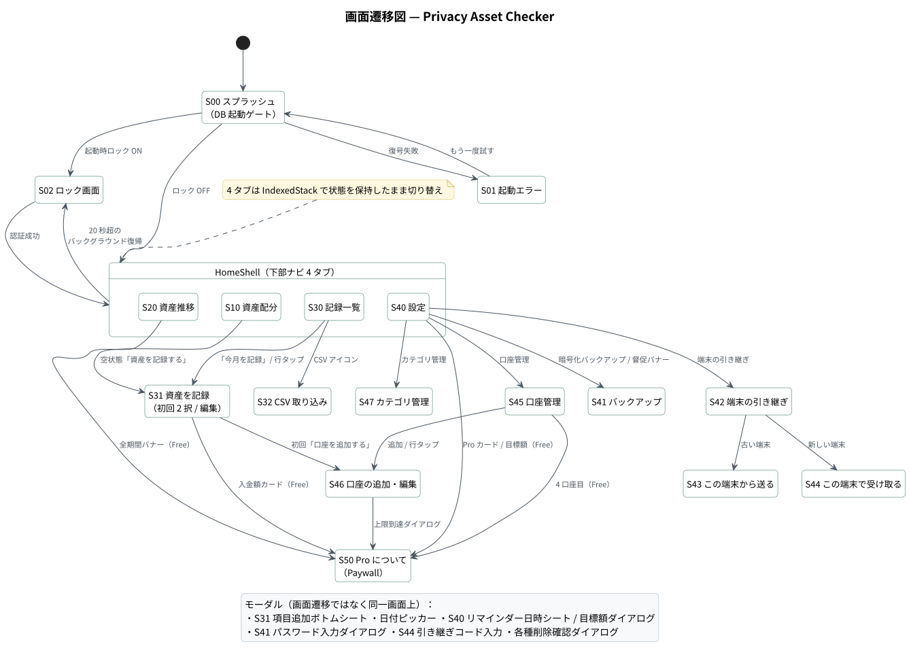

# 画面定義書 — Privacy Asset Checker

| 項目 | 内容 |
|---|---|
| 対象 | Privacy Asset Checker v1.0.0（Flutter / iOS・Android） |
| 画面数 | 17 画面（ゲート 3 ／ タブ 4 ／ サブ画面 10） |
| 画面遷移図 | [diagrams/svg/screen-transition.svg](diagrams/svg/screen-transition.svg) |
| 共通仕様 | 縦画面固定・ライト／ダーク自動切替・金額は `int`（円）で保持し表示時のみ整形・数字は等幅（tabular figures） |

---

## 1. 画面一覧

| 画面ID | 画面名 | 区分 | 実装クラス（`lib/src/features/`） | 概要 |
|---|---|---|---|---|
| S00 | スプラッシュ | ゲート | `app.dart` `_SplashScreen` | 暗号化 DB を開く間の待機画面 |
| S01 | 起動エラー | ゲート | `app.dart` `_BootstrapErrorScreen` | DB の復号に失敗したときの案内と再試行 |
| S02 | ロック画面 | ゲート | `lock/app_lock_gate.dart` | 生体認証／端末パスコードで解除 |
| S10 | 資産配分 | タブ 1 | `allocation/allocation_page.dart` | 総資産・目標進捗・カテゴリ構成比・口座別内訳 |
| S20 | 資産推移 | タブ 2 | `trend/trend_page.dart` | 月別の評価額推移、元本ラインと運用損益（Pro） |
| S30 | 記録一覧 | タブ 3 | `records/records_page.dart` | 記録した日付の一覧、記録の追加・削除 |
| S31 | 資産を記録 | サブ | `records/snapshot_editor_page.dart` | 口座 × カテゴリごとの金額入力、前回の複製 |
| S32 | CSV 取り込み | サブ | `csv/csv_import_page.dart` | 証券会社 CSV を端末内で解析して取り込む |
| S40 | 設定 | タブ 4 | `settings/settings_page.dart` | リマインダー・目標・セキュリティ・データ管理 |
| S41 | バックアップ | サブ | `backup/backup_page.dart` | 暗号化バックアップの書き出し／復元 |
| S42 | 端末の引き継ぎ | サブ | `transfer/device_transfer_page.dart` | 送る側／受け取る側の選択 |
| S43 | この端末から送る | サブ | `transfer/transfer_send_page.dart` | LAN 待ち合わせ QR または分割 QR を表示 |
| S44 | この端末で受け取る | サブ | `transfer/transfer_receive_page.dart` | QR を読み取り、引き継ぎコードで復号 |
| S45 | 口座管理 | サブ | `accounts/accounts_page.dart` | 口座の一覧・削除（Free は 3 口座まで） |
| S46 | 口座の追加・編集 | サブ | `accounts/account_edit_page.dart` | 口座名・区分・メモの入力 |
| S47 | カテゴリ管理 | サブ | `categories/categories_page.dart` | 資産分類の追加・改名・削除 |
| S50 | Pro について | サブ | `purchase/paywall_page.dart` | 買い切り 1,200 円の購入・復元 |

---

## 2. 共通仕様

| 項目 | 仕様 |
|---|---|
| ナビゲーション | タブ画面（S10〜S40）は下部 `NavigationBar`。`IndexedStack` で各タブの状態を保持 |
| データ更新 | 書き込み後に `invalidateDataFrom(ref)` で `dbRevisionProvider` を加算し、全読み取り Provider を再実行 |
| 読み込み中 / エラー | `AsyncValue.when` で読み込み中はインジケータ、失敗時は「読み込みに失敗しました: 理由」を表示 |
| 確認ダイアログ | 削除・全置換など取り消せない操作は `confirmDialog(destructive: true)` で必ず確認 |
| 通知 | 操作結果は `SnackBar`（`showSnack`）で表示 |
| 画面遮蔽 | Android は `FLAG_SECURE`、iOS はタスク切り替え時にブラー（全画面共通） |
| Pro 誘導 | Pro 機能に触れたときは `ProUpsellBanner` / `ProBadge` を表示し、タップで S50 へ |

---

## 3. 画面詳細

### S00 スプラッシュ ／ S01 起動エラー

| 項目 | 内容 |
|---|---|
| 表示条件 | `repositoryProvider`（暗号化 DB のオープン）が `loading` → S00、`error` → S01 |
| 遷移先 | 成功時：S02（起動時ロック ON）または S10 |

| No | 項目 | 種別 | 内容 |
|---|---|---|---|
| 1 | アプリアイコン | アイコン | `shield_moon_outlined` |
| 2 | アプリ名 | テキスト | 「プライバシー資産チェッカー」 |
| 3 | 状態メッセージ | テキスト | 「暗号化データベースを開いています…」 |
| 4 | 進捗バー | インジケータ | 幅 120 の `LinearProgressIndicator` |
| 5 | （S01）エラー見出し | テキスト | 「データベースを開けませんでした」 |
| 6 | （S01）原因の説明 | テキスト | 暗号キーを読み出せない可能性と、バックアップ復元の案内 |
| 7 | （S01）例外内容 | テキスト | 例外の文字列をそのまま表示（問い合わせ用） |
| 8 | （S01）もう一度試す | ボタン | `ref.invalidate(repositoryProvider)` で再オープン |

---

### S02 ロック画面

| 項目 | 内容 |
|---|---|
| 表示条件 | 設定「起動時にロックする」が ON、かつ端末に認証手段がある |
| 再ロック | バックグラウンド滞在が 20 秒以上で、復帰時に再表示 |
| 遷移先 | 認証成功 → 直前の画面（初回は S10） |

| No | 項目 | 種別 | 内容 |
|---|---|---|---|
| 1 | 指紋アイコン | アイコン | 円形背景つき |
| 2 | アプリ名 | テキスト | 「プライバシー資産チェッカー」 |
| 3 | 説明 | テキスト | 「あなたの資産データは端末の中だけにあります」 |
| 4 | ロックを解除 | ボタン | `BiometricService.authenticate()`。認証中は「認証中…」に変わり無効化 |

| 業務ルール |
|---|
| 認証手段が使えない端末では締め出しを避けるため、ロックを素通しする |
| 起動時に保存済み設定から画面遮蔽・リマインダー予約を再適用する |

---

### S10 資産配分

 

| 項目 | 内容 |
|---|---|
| 遷移元 | 起動直後 ／ 下部ナビ「資産配分」 |
| 遷移先 | S31（記録が 0 件のときの「資産を記録する」） |
| 利用プラン | Free（目標進捗の表示は Pro で目標額を設定した場合のみ） |

| No | 項目 | 種別 | 内容・表示ルール |
|---|---|---|---|
| 1 | 表示時点 | ポップアップメニュー | 「2026年7月 ▼」。記録した日付の一覧＋「最新」から選択（`selectedSnapshotDateProvider`） |
| 2 | 総資産 | 金額（大） | 対象日の全明細の合計。見出しに「2026年7月28日時点」 |
| 3 | 前回比 | 金額（符号付き） | 1 つ前の記録日との差額。増加は緑、減少は赤 |
| 4 | 目標までの進捗 | プログレスバー | 達成率（%）、残額、目標額。目標未設定なら非表示 |
| 5 | カテゴリ別構成比 | ドーナツグラフ | 中央に合計（万円）。色はカテゴリ色 |
| 6 | カテゴリ別一覧 | リスト | 名前・構成比（%）・金額・比率バー。金額の降順 |
| 7 | 保有口座 | リスト | 口座名・区分・金額・構成比と、カテゴリ内訳バッジ（例「米国株 301万」） |
| 8 | フッター | テキスト | 「このデータは端末内の暗号化データベースにのみ保存されています」 |
| 9 | 空状態 | EmptyState | 「まだ資産が登録されていません」＋「資産を記録する」ボタン |

---

### S20 資産推移

 

| 項目 | 内容 |
|---|---|
| 遷移元 | 下部ナビ「推移」 |
| 遷移先 | S50（Free 時の「全期間の推移を表示」バナー） |
| 利用プラン | Free：直近 3 ヶ月（`applyFreeTrendLimit`）／ Pro：全期間＋元本ライン |

| No | 項目 | 種別 | 内容・表示ルール |
|---|---|---|---|
| 1 | 最新の総資産 | 金額（大） | 最新月の合計 |
| 2 | 期間内の増減 | 金額（符号付き） | 表示期間の先頭月からの差額（「2026年5月から」） |
| 3 | 積み上げた元本 ／ 運用による損益 | 金額 2 列 | Pro かつ入金データがある場合のみ（`hasContributionData`） |
| 4 | 推移グラフ | 折れ線グラフ（fl_chart） | 月ごとの代表値（その月の最新記録日）。Pro は元本ラインを破線で重ねる |
| 5 | 凡例 | テキスト | 「評価額」「元本」（元本ライン表示時のみ） |
| 6 | Pro 誘導バナー | ProUpsellBanner | 「Free では直近 3 ヶ月分を表示しています（n 件分が非表示）」 |
| 7 | 月ごとの推移 | リスト | 年月・前月比・評価額。Pro は「入金 ¥100,000」を併記 |

| 業務ルール |
|---|
| 元本 ＝ 最初の記録時点の評価額 ＋ それ以降の入金累計（`attachPrincipal`）。初回月の入金は二重計上しない |
| 運用損益 ＝ 評価額 − 元本 |

---

### S30 記録一覧

| 項目 | 内容 |
|---|---|
| 遷移元 | 下部ナビ「記録」 |
| 遷移先 | S31（「今月を記録」／ 行タップ）、S32（CSV アイコン） |

| No | 項目 | 種別 | 内容・操作 |
|---|---|---|---|
| 1 | CSV を取り込む | アイコンボタン（AppBar） | S32 へ遷移 |
| 2 | 記録日 | リスト行 | 日付・「n 件の内訳」・合計金額。新しい順。タップで S31（その日付を編集） |
| 3 | 削除 | アイコンボタン | 確認ダイアログ後に `deleteSnapshot(date)`（明細と入金額をトランザクションで削除） |
| 4 | 今月を記録 | FAB | S31（今日の日付で新規） |
| 5 | 空状態 | EmptyState | 口座 0 件なら「口座を追加」、口座ありで記録 0 件なら「最初の記録をつくる」 |

---

### S31 資産を記録

   

| 項目 | 内容 |
|---|---|
| 遷移元 | S10 空状態 ／ S30 |
| 遷移先 | 保存・破棄で元の画面へ戻る ／ S46（初回「口座を追加する」）／ S50（Free で入金額カード） |
| 入力単位 | 口座 × カテゴリ × 日付（`asset_records` の一意キー） |

| No | 項目 | 種別 | 内容・表示ルール |
|---|---|---|---|
| 1 | 保存 | テキストボタン（AppBar） | `saveSnapshot(date, drafts, contribution)` |
| 2 | 件数と合計 | テキスト／金額 | 「5 件の合計 ¥8,460,000」。入力に合わせて即時再計算 |
| 3 | 記録日 | 日付ボタン | 日付ピッカーで変更 |
| 4 | 初回の 2 択 | カード × 2 | 口座 0 件のとき表示。「総額だけで始める」／「口座を追加する」 |
| 5 | 前回のデータを 1 タップで複製 | カード | 前回の口座 × カテゴリ × 金額をそのまま引き継ぐ（`source = duplicated`） |
| 6 | 口座セクション | カード | 口座名と小計。配下にカテゴリ行 |
| 7 | 金額 | 数値入力（AmountField） | 円。3 桁区切りで表示 |
| 8 | 行の削除 | アイコンボタン | この項目を削除 |
| 9 | 今月の入金額（任意） | 数値入力 | Pro のみ。Free は Pro 誘導カード |
| 10 | 項目を追加 | FAB | ボトムシートで口座とカテゴリを選択 |

| No | 入力チェック・業務ルール | メッセージ |
|---|---|---|
| 1 | 金額が 1 件も入力されていなければ保存しない | 「金額を 1 件以上入力してください」 |
| 2 | 同じ口座 × カテゴリの行は追加できない | 「その口座とカテゴリの組み合わせは既にあります」 |
| 3 | 複製元の記録がない | 「複製できる過去の記録がありません」 |
| 4 | 金額 0 の行は保存しない（削除扱い） | — |
| 5 | 未保存の変更がある状態で戻る | 「破棄する」確認ダイアログ |
| 6 | 保存はその日付の明細を全置換（1 トランザクション） | 「2026年7月28日の記録を保存しました」 |

---

### S32 CSV 取り込み

 

| 項目 | 内容 |
|---|---|
| 遷移元 | S30（AppBar の CSV アイコン） |
| 遷移先 | 取り込み完了で S30 へ戻る |
| 対応形式 | SBI 証券・楽天証券の「保有商品一覧」CSV（UTF-8 / UTF-8 BOM / Shift-JIS を自動判定） |

| No | 項目 | 種別 | 内容・表示ルール |
|---|---|---|---|
| 1 | 対応する CSV | 説明カード | 対応形式と「列の並びが変わっても取り込める」旨 |
| 2 | この機能について | 説明カード | ベストエフォート提供である旨（書式変更で読めない場合は手入力） |
| 3 | プライバシー | 説明カード | 「選んだファイルは端末の外に出ません」 |
| 4 | CSV ファイルを選ぶ | ボタン | `file_picker` で選択 → `CsvTextDecoder` → `BrokerageCsvParser` |
| 5 | 読み取り結果 | 表 | ファイル名・書式・文字コード・明細数・合計評価額 |
| 6 | 取り込み先 | ドロップダウン | 口座を選択 |
| 7 | 日付 | テキスト＋変更 | 既定は今日 |
| 8 | カテゴリ別の集計 | リスト | 割り当て後のカテゴリ別合計 |
| 9 | 明細とカテゴリの割り当て | リスト＋ドロップダウン | 銘柄名・金額ごとに推定カテゴリを初期値として表示。変更可 |
| 10 | 選び直す ／ この内容で取り込む | ボタン | 取り込みは口座未選択の間は無効 |

| 業務ルール |
|---|
| 同じ日付の**他口座の記録は残したまま**、対象口座の分だけを置き換える |
| 明細はカテゴリごとに合算して保存する（`source = csv`） |
| 解析に失敗した場合は「CSV を読み込めませんでした: 理由」を表示 |

---

### S40 設定

 

| 項目 | 内容 |
|---|---|
| 遷移元 | 下部ナビ「設定」 |
| 遷移先 | S41 / S42 / S45 / S47 / S50 |

| No | グループ | 項目 | 種別 | 内容・操作 |
|---|---|---|---|---|
| 1 | — | バックアップ督促 | 警告バナー | 記録があるのにバックアップがない、または 30 日以上経過で表示（`evaluateBackupStatus`）。タップで S41 |
| 2 | — | Pro（買い切り） | カード | Free は内容と S50 への導線。Pro は「すべての機能が利用できます」 |
| 3 | 毎月の記録 | 入力リマインダー | スイッチ | ON 時に通知権限を要求し、毎月のローカル通知を予約 |
| 4 | 毎月の記録 | 通知するタイミング | 選択（ボトムシート） | 日（1〜28）と時刻。既定は毎月 25 日 20 時 |
| 5 | 目標 | 目標資産額 | ダイアログ（Pro） | Free はタップで S50 |
| 6 | セキュリティ | 起動時にロックする | スイッチ | 生体認証／端末パスコード |
| 7 | セキュリティ | スクリーンショットを防ぐ | スイッチ（Android） | iOS では「タスク切り替え時の画面遮蔽（常に有効）」の説明行に置き換え |
| 8 | データ | 暗号化バックアップ | リンク | S41 |
| 9 | データ | 端末の引き継ぎ | リンク | S42 |
| 10 | データ | 口座管理 | リンク | S45（「n 件を登録中」） |
| 11 | データ | カテゴリ管理 | リンク | S47 |
| 12 | このアプリが守っていること | 約束の一覧 | テキスト | `AppInfo.privacyPledges`（README の「通信について」と同じ内容） |
| 13 | その他 | バージョン | テキスト | `AppInfo.version` |
| 14 | その他 | すべてのデータを削除 | 危険操作 | 確認ダイアログ「完全に削除」後に全テーブルを削除 |
| 15 | デバッグ | Pro 切り替え | スイッチ | `kDebugMode` のときだけ表示（リリースビルドではコードごと消える） |

---

### S41 バックアップ

| No | 項目 | 種別 | 内容・操作 |
|---|---|---|---|
| 1 | 督促バナー | 警告 | 「まだバックアップがありません」／「前回から 30 日以上経っています」 |
| 2 | 暗号化して書き出す | 説明＋ボタン | 前回の書き出し日時。ボタンでパスワード入力（確認つき）→ `.pacbk` を共有シートへ |
| 3 | バックアップから復元 | 説明＋ボタン | ファイル選択 → パスワード入力 → 内容確認 → 全置換 |
| 4 | 仕様 | 表 | 拡張子 `.pacbk`・PBKDF2-HMAC-SHA256・210,000 回・AES-256-GCM・gzip |
| 5 | 注意書き | テキスト（赤） | 「パスワードを忘れると復元できません。アプリ側にも復旧手段はありません」 |

| No | 入力チェック | メッセージ |
|---|---|---|
| 1 | パスワードは 8 文字以上 | 「8 文字以上にしてください」 |
| 2 | 確認用と一致すること | 「パスワードが一致しません」 |
| 3 | 別アプリのファイル | 「このアプリのバックアップファイルではありません」 |
| 4 | パスワード違い・改ざん | `BackupException` の日本語メッセージ |

---

### S42 端末の引き継ぎ ／ S43 この端末から送る ／ S44 この端末で受け取る

| 項目 | 内容 |
|---|---|
| 遷移元 | S40「端末の引き継ぎ」 |
| 経路 | ① LAN 直接転送（既定）② 分割 QR（フォールバック）。受信側は QR の中身で経路を自動判別 |
| シーケンス | [diagrams/svg/seq-transfer.svg](diagrams/svg/seq-transfer.svg) |

| 画面 | No | 項目 | 種別 | 内容・操作 |
|---|---|---|---|---|
| S42 | 1 | この端末から送る（古い端末） | ボタン | S43 へ |
| S42 | 2 | この端末で受け取る（新しい端末） | ボタン | S44 へ |
| S42 | 3 | 知っておいてほしいこと | 説明 | 旧端末が動くことが前提で、バックアップの代わりにはならない旨 |
| S43 | 1 | 準備中表示 | インジケータ | 「データを暗号化しています…」（鍵導出に 1〜2 秒） |
| S43 | 2 | 引き継ぎコード | テキスト（大） | 8 桁。QR には載せず画面に文字で表示 |
| S43 | 3 | QR | QR コード | LAN：`PACL1\|token\|hosts\|port` ／ 分割：220ms ごとにフレーム切替 |
| S43 | 4 | 手順 | テキスト | 新端末での操作手順 1〜3 |
| S43 | 5 | 経路切替 | ボタン | 「繋がらないので QR だけで送る」⇔「Wi-Fi 経由に戻す」 |
| S44 | 1 | カメラプレビュー | MobileScanner | 権限拒否時は専用のエラー表示 |
| S44 | 2 | 進捗 | テキスト／バー | 分割 QR の読み取り済み枚数 |
| S44 | 3 | 引き継ぎコードを入力 | ボタン＋ダイアログ | 復号 → 内容確認 → 「取り込む」で全置換 |

| 業務ルール |
|---|
| LAN 待ち受けは 5 分間アクセスがなければ自動停止。トークン不一致は 404（存在自体を伏せる） |
| 受信側は候補アドレスを 192.168 → 10. → 172.16-31 の順に 4 秒ずつ試す |
| 引き継ぎコードの入力ミスでは受信データを捨てず、コードの入れ直しだけでやり直せる |

---

### S45 口座管理 ／ S46 口座の追加・編集

| 画面 | No | 項目 | 種別 | 内容・操作 |
|---|---|---|---|---|
| S45 | 1 | 登録口座数 n / 3 | Pro 誘導バナー | Free のみ表示。タップで S50 |
| S45 | 2 | 口座 | リスト行 | 口座名・区分。タップで S46（編集） |
| S45 | 3 | 削除 | アイコンボタン | 記録件数を示した確認ダイアログ後に削除（関連する記録も CASCADE で削除） |
| S45 | 4 | 口座を追加 ／ Pro で無制限に | FAB | 上限未満なら S46、上限なら S50 |
| S46 | 1 | 口座名 | テキスト入力（必須） | ヒント「SBI証券 / 楽天銀行 など」 |
| S46 | 2 | 区分 | ドロップダウン | 特定口座／一般口座／NISA 成長投資枠／NISA つみたて投資枠／iDeCo／銀行口座／暗号資産取引所／その他 |
| S46 | 3 | メモ（任意） | テキスト入力 | 用途や運用方針など |

| No | 入力チェック | メッセージ |
|---|---|---|
| 1 | 口座名が空 | 「口座名を入力してください」 |
| 2 | 同じ名前 × 区分が既にある（UNIQUE 制約） | 「同じ名前と区分の口座が既にあります」 |
| 3 | Free で 4 口座目 | 「Pro を見る」確認ダイアログ → S50 |

---

### S47 カテゴリ管理

| No | 項目 | 種別 | 内容・操作 |
|---|---|---|---|
| 1 | 説明 | テキスト | 「グラフの色は、見分けやすさを保つためにアプリ側で自動的に割り当てます」 |
| 2 | カテゴリ | リスト行 | 色ドット・名前。タップで改名（ボトムシート） |
| 3 | 削除 | アイコンボタン | 記録で使われているカテゴリは削除不可（FK `ON DELETE RESTRICT`） |
| 4 | カテゴリを追加 | FAB | ボトムシートで名前を入力 |

| No | 入力チェック | メッセージ |
|---|---|---|
| 1 | 同じ名前が既にある | 「同じ名前のカテゴリが既にあります」 |
| 2 | 使用中のカテゴリを削除 | 「記録で使われているため削除できません」 |

---

### S50 Pro について（Paywall）

| 項目 | 内容 |
|---|---|
| 遷移元 | S20 / S31 / S40 / S45 / S46 の各 Pro 誘導 |
| シーケンス | [diagrams/svg/seq-purchase.svg](diagrams/svg/seq-purchase.svg) |

| No | 項目 | 種別 | 内容・操作 |
|---|---|---|---|
| 1 | ヒーロー | カード | 「一度だけの支払いで、ずっと使えます」・価格（ストア取得、失敗時は ¥1,200） |
| 2 | できること | 比較表 | Free / Pro の機能比較（口座数・推移期間・入金額・目標・バックアップほか） |
| 3 | なぜサブスクではないのか | 説明 | サーバーを持たないので維持費がかからない、という理由 |
| 4 | ¥1,200 で Pro にする | ボタン | `PurchaseController.buy()`。処理中はインジケータ |
| 5 | 購入を復元する | ボタン | `restore()`。4 秒で結果がなければ「復元できる購入はありませんでした」 |
| 6 | 閉じる | ボタン | 元の画面へ |
