# Privacy Asset Checker（プライバシー資産チェッカー）

> 澤井直輝のポートフォリオ作品のひとつです（[作品一覧へ](https://github.com/sawai-naoki-portfolio)）。

通信を一切行わない、端末内完結の資産管理アプリ（Flutter / iOS・Android）。

資産額・口座・保有内訳といった機微なデータをサーバーに預けたくない個人投資家向けに、
**アプリからのネットワーク通信を持たない**設計にしています。データは端末内の
AES-256 暗号化 SQLite にのみ保存され、復号キーは iOS Keychain / Android Keystore に置かれます。

<table>
<tr>
<td width="33%">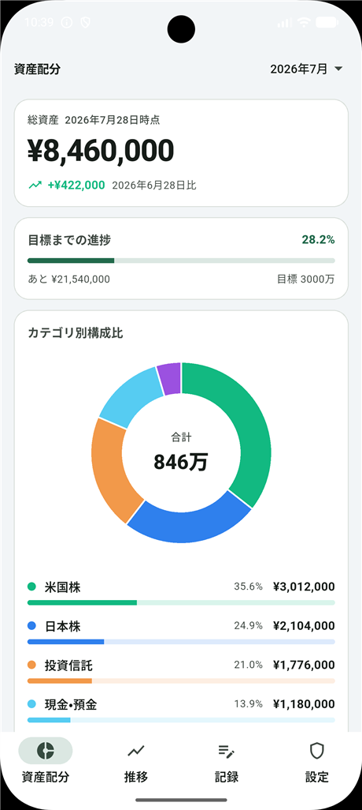</td>
<td width="33%">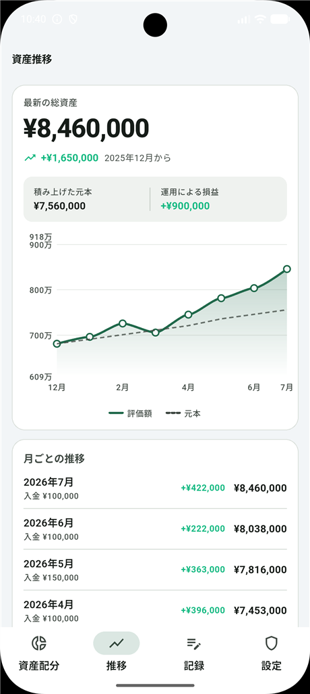</td>
<td width="33%">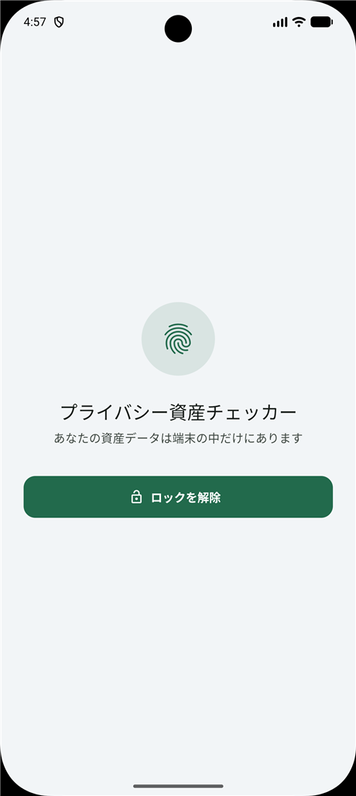</td>
</tr>
<tr>
<td align="center"><b>資産配分</b><br>総資産・構成比・目標への進捗</td>
<td align="center"><b>資産推移</b><br>評価額と元本を重ねて表示</td>
<td align="center"><b>アプリロック</b><br>生体認証・端末パスコード</td>
</tr>
</table>

> **設計ドキュメント** — 要件定義書・画面定義書・設計書（クラス図／シーケンス図／画面遷移図／ER 図）・テスト仕様は
> [`Doc/`](Doc/README.md) にまとめています。

---

## 設計の考え方

このアプリには、機能を足すときに毎回立ち返っている 3 つの判断基準があります。

**1. データを守る機能に課金しない**
端末内完結ということは、端末を失った瞬間にデータが全損するということです。
その唯一の救済手段である暗号化バックアップに値段をつけるのは、
「あなたのデータはあなたのもの」という立場と矛盾します。
バックアップ・生体認証ロック・入力リマインダーは Free でも制限していません。

**2. 思い出してもらえなければ何もかも無価値**
このアプリの中心は月 1 回の記録です。忘れられた瞬間に、1 タップ複製も推移グラフも
意味を失います。だから入力リマインダーを最優先の機能として実装しています。

**3. 約束できないものを売らない**
証券会社の CSV は予告なく書式が変わります。「全証券会社対応」を有料で約束すると、
先方の仕様変更がそのまま返金案件になります。CSV 取り込みは Free で
ベストエフォート提供とし、アプリ内にもその旨を明記しています。

---

## セキュリティ設計

| 項目 | 実装 |
|---|---|
| データ保存 | `sqflite_sqlcipher`（SQLite 全体を AES-256 で暗号化） |
| 暗号キー | 起動時に 256bit 乱数を生成し `flutter_secure_storage` 経由で Keychain / Keystore に保管（`lib/src/data/db/db_key_store.dart`） |
| Keychain 属性 | `first_unlock_this_device` — iCloud キーチェーン経由で他端末へ複製されない |
| アプリロック | `local_auth`（生体認証／端末パスコード）。バックグラウンド 20 秒超で再ロック |
| 画面遮蔽 | 自前のネイティブ実装。Android は `FLAG_SECURE`、iOS はタスク切り替え時にブラー |
| OS バックアップ | Android は `allowBackup=false` + `data_extraction_rules.xml` で全ドメイン除外 |
| 課金状態 | DB ではなく Keychain / Keystore に保存（バックアップ復元で Pro が持ち込まれない） |
| 通知 | 端末内でスケジュール。`SCHEDULE_EXACT_ALARM` は要求しない |

`FLAG_SECURE` は実際に効いており、この README のスクリーンショットは
`adb screencap` では真っ黒になります（エミュレータのコンソール経由で撮影しています）。

### 通信について

**このアプリのためのサーバーは存在しません。** 資産データが開発者側に渡ることはなく、
トラッキング SDK・広告 SDK も組み込んでいません。通信が発生するのは次の 2 つだけです。

1. **アプリ内課金** — 購入・復元の瞬間だけ Apple / Google のストア SDK が
   各社のサーバーと通信します（Android では Play Billing が `INTERNET` を要求）
2. **端末の引き継ぎ（LAN 経由）** — ユーザーが明示的に開始したときだけ、
   同じ Wi-Fi 上の自分のもう 1 台と直接やり取りします。ルーターの外へは出ません

2 は暗号化済みのバイト列を HTTP で渡すだけで、外部のサーバーは一切介しません。
LAN が使えない環境では、通信を伴わない分割 QR の経路にフォールバックします。

> 以前このセクションは「通信量 0 Byte」と書いていました。LAN 経由の引き継ぎを
> 追加した時点で正確でなくなったため、実態に合わせて書き換えています。

---

## 機能比較

| 機能 | Free | Pro（買い切り 1,200 円） |
|---|---|---|
| 登録できる口座数 | 3 口座まで | **無制限** |
| 資産推移グラフ | 直近 3 ヶ月 | **全期間** |
| 入金額の記録・元本ライン | — | **利用可能** |
| 目標額と達成率 | — | **利用可能** |
| 暗号化バックアップ | 利用可能 | 利用可能 |
| CSV ローカル解析 | 利用可能 | 利用可能 |
| 生体認証ロック | 利用可能 | 利用可能 |
| 入力リマインダー | 利用可能 | 利用可能 |
| 広告・トラッキング | なし | なし |

**守る機能は無料、深掘りする機能は有料**という線引きです。
サーバー維持費が 0 円なので、月額を取り続ける理由もありません。

---

## 画面

### 1. 資産配分

総資産と前回記録日との差分を最上部に置き、目標を設定していれば進捗バー、
その下にカテゴリ別のドーナツグラフ、さらに口座ごとの内訳を並べます。

<table>
<tr>
<td width="50%"></td>
<td width="50%">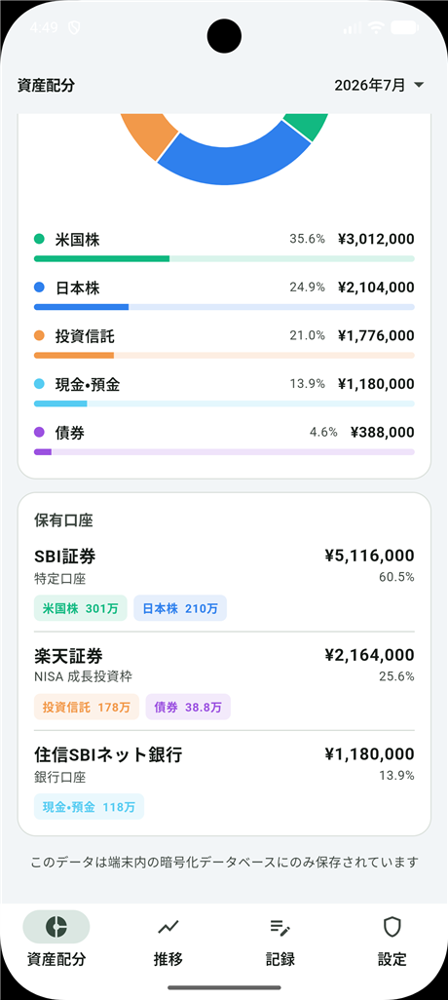</td>
</tr>
<tr>
<td align="center">総資産・目標進捗・構成比</td>
<td align="center">保有口座と内訳バッジ</td>
</tr>
</table>

### 2. 資産推移 — 入金と運用損益を分ける

「資産が増えたのは積み立てたからか、相場が上がったからか」が分からないと、
数字を眺めても判断材料になりません。記録時に入金額を入れておくと、
評価額の下に**元本ライン**が重なり、差分が運用損益として切り出されます。

<table>
<tr>
<td width="50%">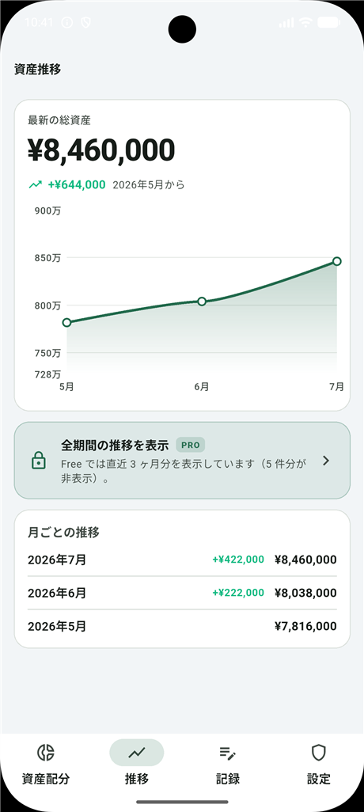</td>
<td width="50%"></td>
</tr>
<tr>
<td align="center">Free：直近 3 ヶ月</td>
<td align="center">Pro：全期間 + 元本ラインと運用損益</td>
</tr>
</table>

### 3. 記録 — 最初の 1 回を軽く、2 回目以降を数秒に

初回は「総額だけ」か「口座ごと」かを選べます。空の画面に放り出しません。
2 回目以降は前回の内訳を 1 タップで複製し、変わった金額だけ直します。

<table>
<tr>
<td width="25%">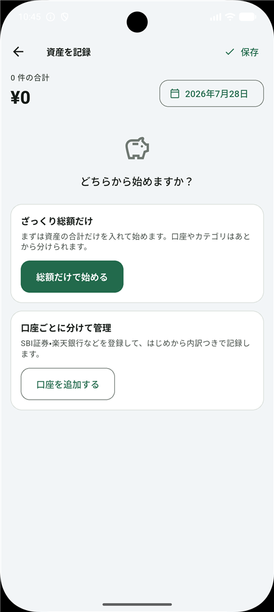</td>
<td width="25%">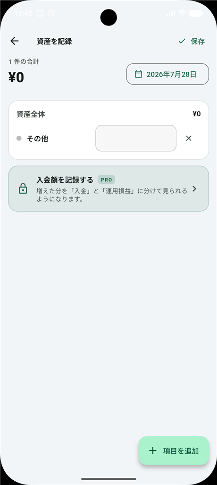</td>
<td width="25%">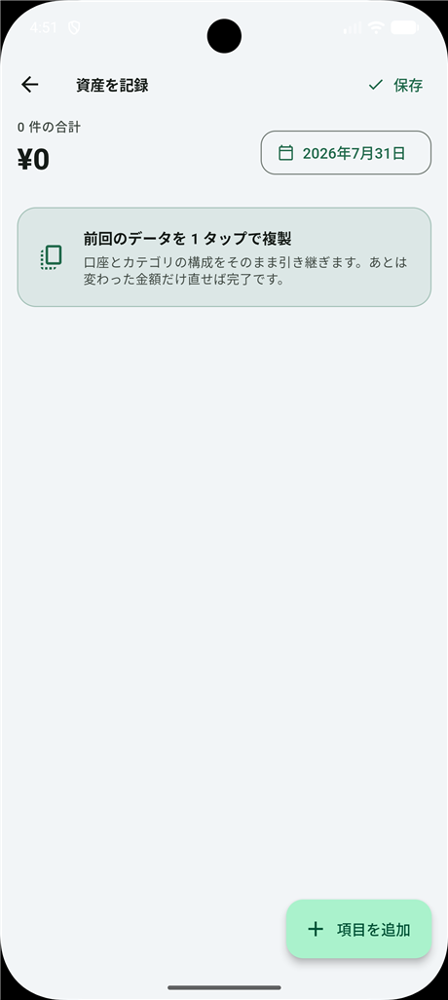</td>
<td width="25%">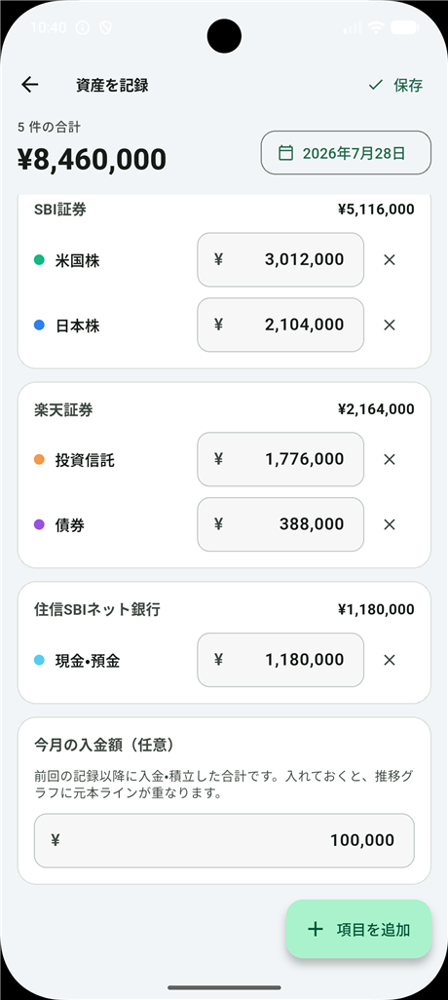</td>
</tr>
<tr>
<td align="center">初回は 2 択から</td>
<td align="center">総額だけで開始</td>
<td align="center">前回を 1 タップ複製</td>
<td align="center">入金額を記録（Pro）</td>
</tr>
</table>

<table>
<tr>
<td width="50%">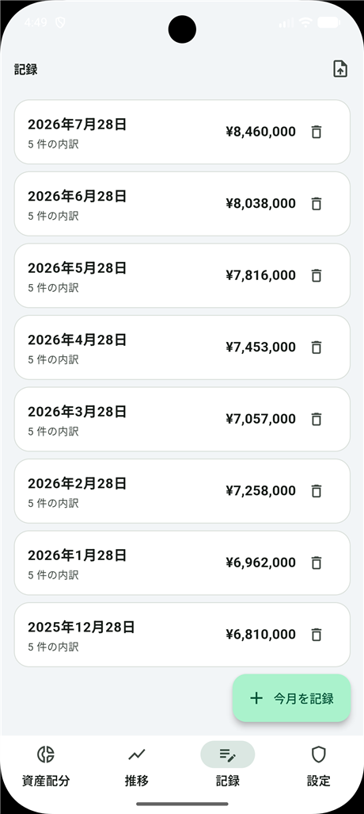</td>
<td width="50%">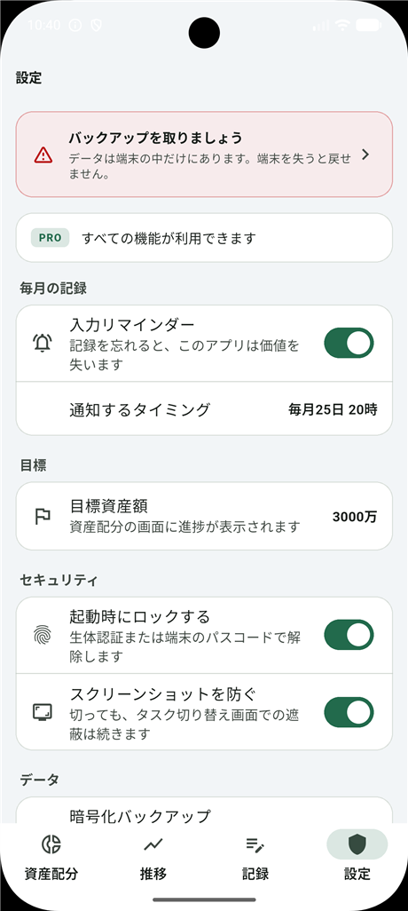</td>
</tr>
<tr>
<td align="center">記録した日付の一覧</td>
<td align="center">入力リマインダーと目標額</td>
</tr>
</table>

### 4. CSV ローカル解析

証券会社の「保有商品一覧」CSV を端末内で解析します。下の例は
**Shift-JIS の SBI 証券形式**を読み込んだところで、文字コード・書式・
カテゴリの割り当てまですべて自動で判定されています。

<table>
<tr>
<td width="50%">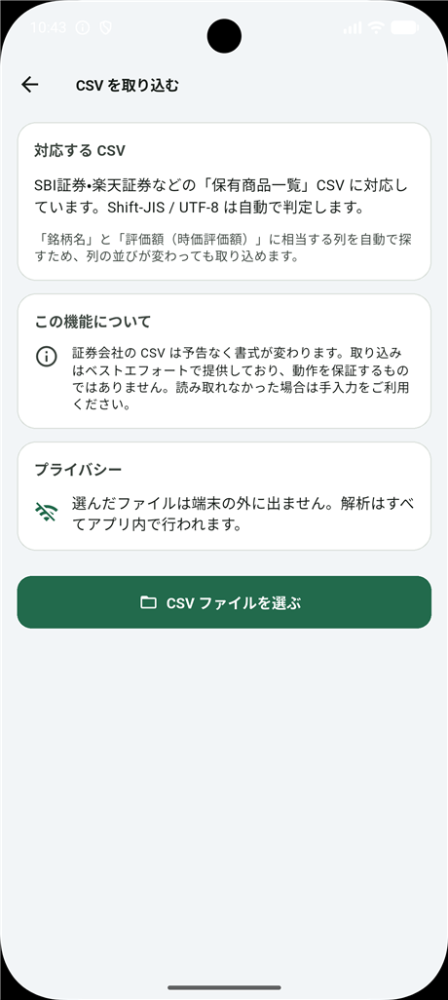</td>
<td width="50%">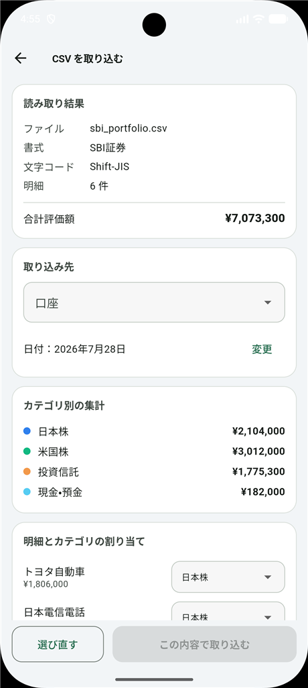</td>
</tr>
<tr>
<td align="center">ファイルは端末の外に出ない</td>
<td align="center">Shift-JIS を自動判定 → カテゴリ別に集計</td>
</tr>
</table>

### 5. 暗号化バックアップと設定

記録があるのにバックアップがない状態、または前回から 30 日以上経った状態では、
設定画面とバックアップ画面の両方で警告を出します。

<table>
<tr>
<td width="50%">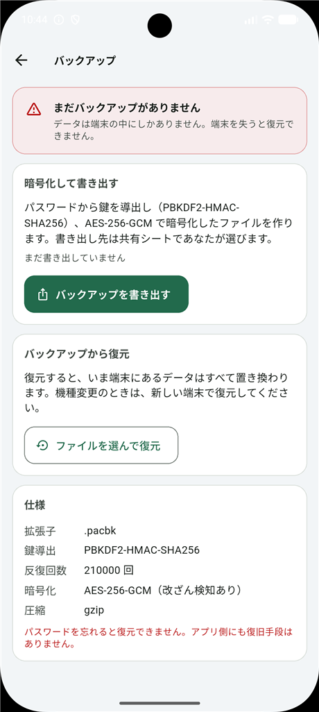</td>
<td width="50%">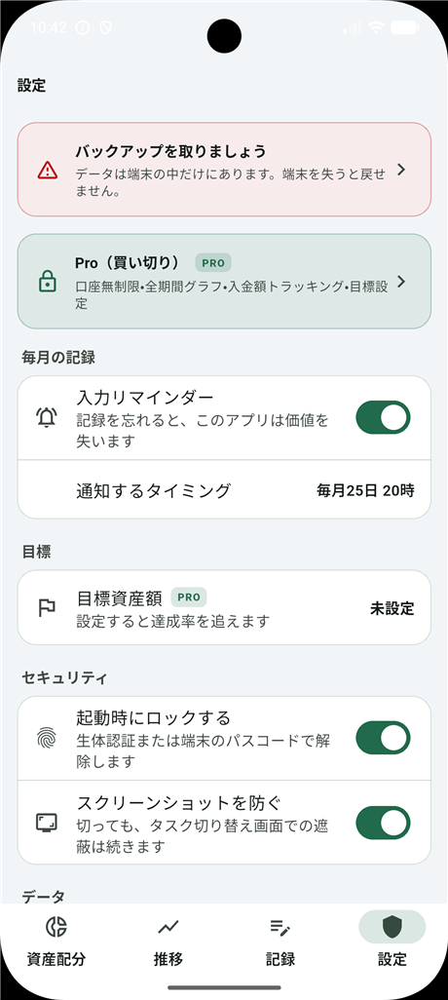</td>
</tr>
<tr>
<td align="center">書き出し / 復元と暗号仕様の明示</td>
<td align="center">バックアップ督促・リマインダー・守っていること</td>
</tr>
</table>

### 6. 口座・カテゴリ管理と Pro

<table>
<tr>
<td width="33%">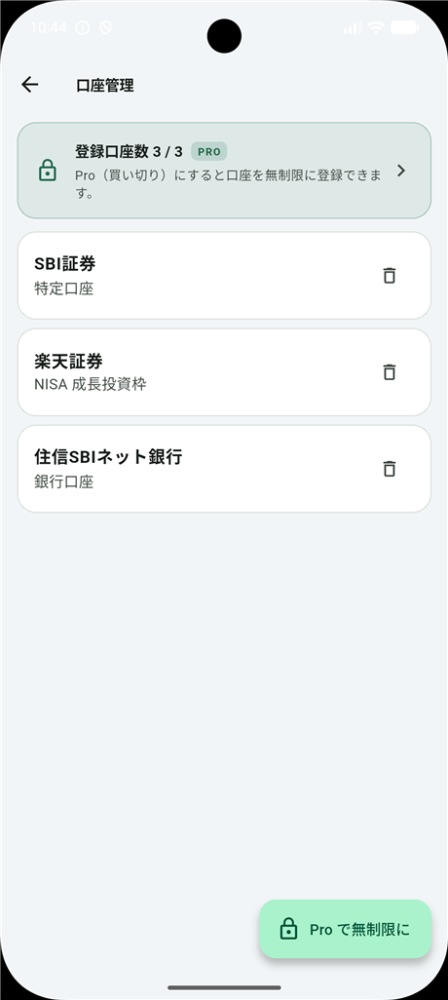</td>
<td width="33%">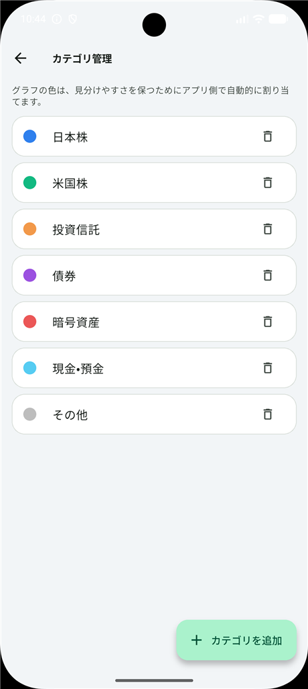</td>
<td width="33%">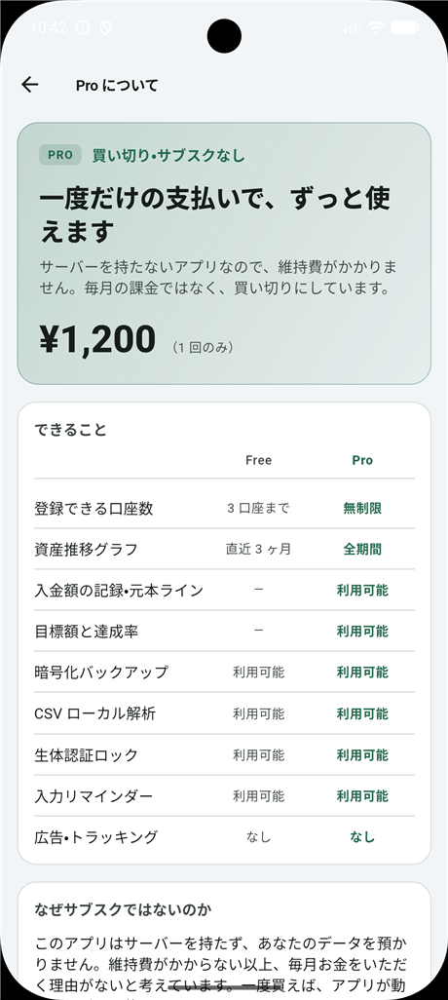</td>
</tr>
<tr>
<td align="center">Free は 3 口座まで</td>
<td align="center">色はアプリが自動で割り当て</td>
<td align="center">買い切り 1,200 円</td>
</tr>
</table>

---

## あえて作らなかったもの

| 見送ったもの | 理由 |
|---|---|
| 年別グラフ | 3 年目まで月別と同じ形にしかならず、トグルの分だけ画面が重くなる |
| カテゴリ色のユーザー編集 | 選ばせてもグラフは読みやすくならず、破綻する配色を選べるようになるだけ |
| 口座の「休止中」状態 | 覚える概念が 1 つ増える割に使われない |
| 記録のメモ欄 | UI を作り込む価値が薄く、入力元は `source` 列で足りている |
| ホーム画面ウィジェット | ロック画面に総資産が出る時点で、このアプリの前提と矛盾する |

---

## ディレクトリ構成

```
lib/
  main.dart                        起動・画面遮蔽の有効化
  src/
    app.dart                       MaterialApp / DB 起動ゲート
    providers.dart                 Riverpod のプロバイダ定義
    core/                          定数・書式・テーマ
    data/
      db/                          暗号化 DB とキー管理
      models/                      Account / AssetRecord / AppSettings ほか
      repositories/                すべての DB アクセス
      csv/                         文字コード判定 + 証券会社 CSV パーサ
      backup/                      暗号化バックアップの生成・復号
    notifications/                 毎月の入力リマインダー
    security/                      生体認証・画面遮蔽
    dev/                           ドキュメント用デモデータ（デバッグ限定）
    features/
      allocation/  trend/  records/  csv/
      accounts/    categories/  backup/  settings/
      purchase/    lock/  shell/
    widgets/                       共通 UI 部品
test/                              CSV・暗号化・集計・設定のテスト
Doc/screenshots/                  この README の画像
```

---

## データベーススキーマ（v2）

```sql
categories    (id, name, color, sort_order)
accounts      (id, name, account_type, note, sort_order)
asset_records (id, account_id, category_id, recorded_on, amount, source)
snapshot_meta (recorded_on, contribution)     -- v2 で追加
app_settings  (key, value)
```

`asset_records` は `(recorded_on, account_id, category_id)` で一意。
「SBI証券の米国株が 301 万円」のような**口座 × カテゴリ**の粒度で記録するため、
1 つの証券口座に複数の資産クラスがあっても正しく集計できます。

`snapshot_meta.contribution` はその日付までの入金額です。元本は
「最初の記録時点の評価額 + それ以降の入金累計」として積み上げます
（`attachPrincipal()`）。使い始める前の損益は追えませんが、
使い始めて以降の増加要因は正しく分離できます。

v1 からの移行は `onUpgrade` で `snapshot_meta` を追加するだけで、既存データは保持されます。

---

## CSV 解析の仕組み

証券会社の CSV は年に数回フォーマットが変わるため、列名を決め打ちしていません。

1. **文字コード判定**：BOM を確認 → UTF-8 として厳密デコード → 失敗したら Shift-JIS
2. **セクション追跡**：単独セルの行を見出し（「株式（現物/特定預り）」など）として記憶
3. **ヘッダー探索**：`銘柄名` / `ファンド名` 系の列と `時価評価額` / `評価額` 系の列をスコアで選択
   （完全一致 > 部分一致。これにより SBI の `銘柄コード` 列を誤選択しない）
4. **カテゴリ推定**：見出しと銘柄名からカテゴリを推定し、取り込み画面で個別に変更可能

上のスクリーンショットは、株式・外国株式・投資信託・預り金の 4 セクションを含む
Shift-JIS の CSV を読み込み、6 明細を 4 カテゴリへ自動で振り分けた実際の結果です。

---

## バックアップ形式（`.pacbk`）

```
JSON 封筒
├─ kdf     : PBKDF2-HMAC-SHA256 / 210,000 回 / salt 16B
├─ cipher  : AES-256-GCM / IV 12B（改ざん検知あり）
├─ payload : base64( AES-GCM( gzip( JSON テーブルダンプ ) ) )
└─ 平文は封筒に一切含まれない
```

鍵導出は UI をブロックしないよう `Isolate.run` で別 isolate に逃がしています。
パスワードはアプリのどこにも保存されないため、忘れると復元手段はありません。

---

## 端末の引き継ぎ

機種変更のとき、2 台を並べてデータを渡せます（[設定] → [端末の引き継ぎ]）。
どちらの経路でもバックアップと同じ `.pacbk` 封筒を作り、運び方だけが変わります。
受信側は**読み取った QR の中身で経路を判別する**ので、ユーザーが経路を選ぶ必要はありません。

### 経路 1：LAN 直接転送（既定）

旧端末が空きポートで待ち受け、QR には**待ち合わせ情報だけ**を載せます。
QR は 1 枚・50 文字前後で済み、転送自体は一瞬で終わります。

```
PACL1|<token 16桁>|<host,host,...>|<port>
```

- `HttpServer.bind(InternetAddress.anyIPv4, 0)` で OS に空きポートを選ばせます
- Wi-Fi・VPN が同時に有効だと正しい IP が一意に決まらないため、
  `NetworkInterface.list()` の候補を**全部**載せ、受信側が順に試します
  （192.168 → 10. → 172.16-31 の順に優先）
- `token` は同じ LAN の別端末に先取りされないための経路。秘匿性の主役は引き継ぎコードです
- 5 分間やり取りがなければ待ち受けを自動的に畳みます
- iOS では `NSLocalNetworkUsageDescription` が必要で、初回に OS の許可ダイアログが出ます

ルーターの **AP アイソレーション**（端末間通信の遮断）が有効だと繋がりません。
その場合は送信側で経路 2 に切り替えます。

### 経路 2：分割 QR（フォールバック）

通信を一切使わず、QR の絵柄だけでデータを渡します。旧端末が 220ms ごとに
フレームを切り替えて表示し続け、新端末が揃うまで読み取ります。

```
PACQ1|<session 8桁>|<index>|<total>|<base64url チャンク>
```

- どのフレームにも全体の枚数が入っているため、**何枚目から読み始めても、順序が
  入れ替わっても**復元できます（`QrTransferAssembler`）
- 1 フレームの本文は 700 文字。誤り訂正レベル M でバージョン 20 前後に収まります
- 封筒の鍵は**転送のたびに生成する 8 桁の引き継ぎコード**から導出し、
  コードは QR に含めず旧端末の画面に文字で表示します。QR を全フレーム
  撮影されただけでは中身を読めません
- セッション ID が変わったフレームを受け取ると、集めた分を捨てて数え直します

### 共通

封筒の鍵は**転送のたびに生成する 8 桁の引き継ぎコード**から導出します。コードは
QR に載せず旧端末の画面に文字で表示するため、QR を撮影されても（LAN の場合は
暗号化データを取得されても）中身は読めません。31 種の英字・数字から 8 桁で約 40bit、
PBKDF2 21 万回と合わせて総当たりに耐える想定です。

**旧端末が動くことが前提**なので、紛失・故障には無力です。バックアップの代わりには
なりません。

プロトコル本体は UI やプラグインに依存しない純 Dart として切り出してあり、
実ソケットを使った往復まで含めてテストしています。

| 実装 | テスト |
|---|---|
| `lib/src/data/transfer/lan_transfer.dart` | `test/lan_transfer_test.dart` |
| `lib/src/data/transfer/qr_transfer_codec.dart` | `test/qr_transfer_codec_test.dart` |

QR の読み取りには `mobile_scanner` を使い、ML Kit は**バンドル版**（`com.google.mlkit:barcode-scanning`）
を選んでいます。非バンドル版は Play 開発者サービス経由でモデルを動的にダウンロードするため、
アプリの外へ通信を増やさない方針と合わないためです。

---

## 画面遮蔽の実装について

外部プラグイン（`screen_protector` など）は Flutter 3.44 の Built-in Kotlin と衝突して
ビルドが通らなかったため、**アプリ自身のネイティブコードで実装**しています。
`MethodChannel("jp.privacyasset/screen_guard")` 越しに Dart から制御します。

| OS | 実装 | できること |
|---|---|---|
| Android | `MainActivity.kt` | `FLAG_SECURE` でスクリーンショット + 最近のタスクのプレビューを封じる。ユーザーがスクリーンショットを許可した場合も、API 33 以降は `setRecentsScreenshotEnabled(false)` でタスク切り替え時の遮蔽だけ維持 |
| iOS | `AppDelegate.swift` の `ScreenGuardPlugin` | アプリ切り替え時にブラーを重ねる。**iOS にスクリーンショットを禁止する公式 API はない**ため、設定画面ではトグルを出さず事実を表示する |

---

## ビルド上の既知の注意点

Flutter 3.44 / AGP 9 の組み合わせは新しく、エコシステム側が追随しきれていません。
以下の回避策を入れてあります。

| 事象 | 回避策 |
|---|---|
| `path_provider_android 2.3.1` が引き込む `jni 1.0.1` が AGP 9 で評価エラー | `pubspec.yaml` で `path_provider_android: ">=2.2.5 <2.3.0"` に固定 |
| プラグインごとに Java と Kotlin の JVM ターゲットが食い違いビルド失敗 | `android/build.gradle.kts` の `gradle.projectsEvaluated` で全サブプロジェクトを Java 17 に統一 |
| `flutter_local_notifications` が `java.time` を要求 | `isCoreLibraryDesugaringEnabled = true` + `desugar_jdk_libs` |
| `share_plus` / `flutter_timezone` が KGP を適用する旨の警告 | 現時点では警告のみ。将来の Flutter で失敗するため、対応版が出たら更新すること |
| `intl` は `flutter_localizations` によって 0.20.2 に固定 | `pubspec.yaml` で明示 |

---

## セットアップ

```bash
flutter pub get
flutter analyze
flutter test
flutter run
```

### 検証状況

- `flutter analyze` — 警告 0
- `flutter test` — 62 件すべて通過
- `flutter build apk --debug` / `--release` — 成功
- Android エミュレータ（Pixel 10 Pro / API 37）で全画面の動作を確認
- **スキーマ v1 → v2 の移行を実機で確認**（既存データを保持したまま `snapshot_meta` を追加）
- **iOS ビルドは未検証**（開発環境が Windows のため）。`AppDelegate.swift` の
  `ScreenGuardPlugin` は macOS 上で一度ビルド確認してください

---

## スクリーンショットの再生成

`lib/src/dev/demo_seed.dart` にドキュメント用のデモデータ投入があります。
`kDebugMode` と `--dart-define` の両方が揃ったときだけ動くため、リリースビルドには混入しません。

```bash
# Free プランの画面
flutter build apk --debug --dart-define=DEMO_MODE=true

# Pro の画面（元本ライン・目標進捗）
flutter build apk --debug --dart-define=DEMO_MODE=true --dart-define=DEMO_PRO=true

# 初回起動の 2 択（デモデータなし）
flutter build apk --debug
```

`FLAG_SECURE` が有効なため `adb screencap` は真っ黒になります。
エミュレータのコンソール経由で撮影してください。

```bash
adb emu screenrecord screenshot <出力先ディレクトリ>
```

---

## テスト

```bash
flutter test
```

- `test/brokerage_csv_parser_test.dart` — SBI / 楽天形式、金額パース、カテゴリ推定
- `test/csv_text_decoder_test.dart` — BOM・UTF-8・Shift-JIS フォールバック
- `test/backup_service_test.dart` — PBKDF2 既知ベクタ、暗号化往復、平文残留の検査
- `test/models_and_formatters_test.dart` — 集計ロジックと表示書式
- `test/trend_and_settings_test.dart` — 元本の積み上げ、Free 制限、バックアップ督促判定、設定のパース
- `test/qr_transfer_codec_test.dart` — 分割 QR の往復、順序入れ替え、重複、セッション切り替え
- `test/lan_transfer_test.dart` — 待ち合わせ情報のパース、実ソケットでの転送、トークン不一致、候補アドレスの総当たり

---

## リリース前に必要な作業

**まず Google Play のみを対象とします。** iOS のリリースは当面予定していないため、
App Store 向けの作業は後回しにしています（コード自体は iOS でも動く状態を維持）。

### Google Play（先にやる）

- [ ] **署名設定**：`android/app/build.gradle.kts` の release 署名。
      現在は debug キーのままなので、**内部テストにもアップロードできません**
- [x] **applicationId** を自分のものに変更（`com.naokisawai.assetchecker`）
- [ ] **課金プロダクトの登録**：Play Console で非消費型アイテム
      `com.naokisawai.assetchecker.pro_lifetime`（1,200 円）を作成し有効化
      （ID は `lib/src/core/constants.dart` の `IapProducts`）。
      商品は**アプリを一度アップロードした後**でないと取得できません
- [ ] **ライセンステスターの登録**：課金フローの実機確認に必要
- [ ] **アプリアイコン / 通知アイコン** の差し替え（通知は現在ランチャーアイコンを流用）
- [ ] **プライバシーポリシーの URL**：データ収集がなくても掲載は必須
- [ ] **データセーフティフォーム**：収集項目なしで申告。
      カメラ（QR 読み取り）とローカルネットワーク（端末間引き継ぎ）は
      端末内・LAN 内で完結し収集にあたらない旨を整理しておくこと
- [ ] **コンテンツレーティング**
- [ ] **クローズドテスト**：個人開発者アカウントの場合、本番公開前に
      12 人・14 日間のテストが要求されることがあります（アカウント作成時期による）

### App Store（iOS を出すことになったら）

- [ ] **`_BootstrapGate` の不具合**：機種変更で iCloud バックアップから復元すると、
      `Documents` の暗号化 DB は移るのに Keychain の鍵は移らない
      （`db_key_store.dart` の `first_unlock_this_device` は仕様どおりの挙動）。
      結果として復号できない DB だけが残り、`app.dart` のエラー画面から先へ進めず、
      **バックアップ復元画面にも到達できません**。
      `DbKeyStore.hasDatabaseKey()` で検出し、孤立した DB を捨てて
      やり直せる導線が必要です（現在この 2 つのメソッドは未使用）
- [ ] **課金プロダクトの登録**：App Store Connect で同じ ID の非消費型を作成。
      **有料 App 契約が有効でないと商品は一切返りません**
- [ ] **輸出コンプライアンス**：AES-256 を使うため、提出時に
      `ITSAppUsesNonExemptEncryption` の申告が必要。該当する免除区分は
      自分で確認のうえ Info.plist に追記すること（誤った申告を避けるため未設定）
- [ ] **プライバシーマニフェスト**：収集項目なしで申告
- [ ] **起動時の購入復元**：中断した購入の拾い直しは Android のみ有効
      （iOS で無条件に呼ぶとサインインを求められるため）。
      iOS では Paywall の「購入を復元する」が唯一の導線になります
